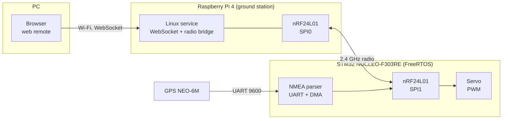

# STM32-GPS-RADIO

An STM32 (NUCLEO-F303RE) reads a GPS module, receives control commands and sends telemetry over a 2.4 GHz **nRF24L01** radio link. A Raspberry Pi 4 works as the ground station: it holds the other end of the radio link and serves a web remote control to a PC browser.

The project is built in small stages. Each stage ends with a working, testable result.

## Architecture



Data flow: commands go browser, Raspberry, radio, STM32 (servo). GPS position goes the other way: GPS, STM32, radio, Raspberry, browser.

## Roadmap

| Stage | Goal | Needs hardware | Status |
|---|---|---|---|
| 0 | Repository, folder structure, `nmea.h` interface | no | done |
| 1 | NMEA parser in C with host tests (checksum, GGA, RMC) | no | in progress |
| 2 | GPS on STM32: UART + DMA, parser in a FreeRTOS task | NEO-6M, wires | planned |
| 3 | nRF24 radio link: SPI driver on STM32 and on Raspberry (`spidev`) | 2x nRF24, wires | planned |
| 4 | Control and telemetry: servo commands over radio, GPS data back | STM32 + Raspberry | planned |
| 5 | Web remote: Raspberry service (systemd), WebSocket, browser UI | Raspberry + radio | planned |
| 6 | Polish: SPI flash logger, debugging session, demo video | W25Q64 | later |

Progress details for stage 1:

- [x] `libs/nmea/nmea.h`: `GpsData_t`, `NMEA_Status_t`, `NMEA_ParseLine`, `NMEA_Checksum`
- [ ] First host test for `NMEA_Checksum` (known good sentences)
- [ ] `NMEA_Checksum` implementation
- [ ] GGA parsing, then RMC parsing
- [ ] Bad-input tests (wrong checksum, empty fields, truncated line, too long)

## Hardware

| Part | Purpose | Notes |
|---|---|---|
| NUCLEO-F303RE | main MCU board | Cortex-M4F, ST-LINK on board |
| Raspberry Pi 4 | ground station | Raspberry Pi OS Lite, SSH |
| GPS module GY-NEO6MV2 (NEO-6M) | position | UART, NMEA, 3.3 V logic, needs sky view to get a fix |
| 2x nRF24L01 | radio link | 3.3 V only, add a 10 uF capacitor across VCC and GND at each module |
| Servo (MG90S) | demo actuator | 5 V supply, common ground with the Nucleo |
| W25Q64 SPI flash | logger (stage 6) | 3.3 V |
| Dupont wires (male-female, female-female) | connections | |

## Wiring (planned)

All pin choices are a plan: confirm them in CubeMX and by the silkscreen on each module before connecting.

### Pin plan on the Nucleo

| Function | Pin | Peripheral / AF |
|---|---|---|
| GPS TX to MCU RX | PC5 | USART1_RX, AF7 |
| GPS RX from MCU TX | PC4 | USART1_TX, AF7 |
| Radio SCK | PA5 | SPI1_SCK, AF5 |
| Radio MISO | PA6 | SPI1_MISO, AF5 |
| Radio MOSI | PA7 | SPI1_MOSI, AF5 |
| Radio CSN (chip select) | PB0 | GPIO output |
| Radio CE | PB1 | GPIO output |
| Radio IRQ | PC0 | GPIO input, EXTI0 |
| Servo signal | PB6 | TIM4_CH1, AF2 |
| Debug console to PC | PA2 / PA3 | USART2 (ST-LINK virtual COM port) |

Why the servo is on PB6 and not PA6: `PA6` is also `SPI1_MISO`, so the two would collide.

### GPS NEO-6M to Nucleo

| GPS module | Nucleo |
|---|---|
| VCC | 3V3 |
| GND | GND |
| TXD | PC5 (MCU RX) |
| RXD | PC4 (MCU TX) |

TX and RX are crossed. The default GPS baud rate is 9600 (check the module).

### nRF24L01 to Nucleo

Standard 8-pin module (2x4 header), check the silkscreen:

| nRF24 pin | Nucleo |
|---|---|
| VCC | 3V3 (never 5 V) |
| GND | GND |
| SCK | PA5 |
| MOSI | PA7 |
| MISO | PA6 |
| CSN | PB0 |
| CE | PB1 |
| IRQ | PC0 |

### nRF24L01 to Raspberry Pi 4 (40-pin header, SPI0)

| nRF24 pin | Raspberry Pi pin | GPIO |
|---|---|---|
| VCC | pin 1 | 3V3 |
| GND | pin 6 | GND |
| SCK | pin 23 | GPIO11 (SCLK) |
| MOSI | pin 19 | GPIO10 (MOSI) |
| MISO | pin 21 | GPIO9 (MISO) |
| CSN | pin 24 | GPIO8 (CE0) |
| CE | pin 22 | GPIO25 |
| IRQ | pin 18 | GPIO24 |

Enable SPI on the Pi: `sudo raspi-config`, Interface Options, SPI. Then `/dev/spidev0.0` should exist.

### Servo

| Servo wire | Connect to |
|---|---|
| Signal | PB6 |
| Power | 5 V |
| Ground | GND (common with the Nucleo) |

### W25Q64 flash (stage 6, planned)

The board labels are DI (MOSI), DO (MISO), CLK (SCK), CS.

| Flash pin | Nucleo |
|---|---|
| VCC | 3V3 |
| GND | GND |
| CLK | PB13 (SPI2_SCK, AF5) |
| DO (MISO) | PB14 (SPI2_MISO, AF5) |
| DI (MOSI) | PB15 (SPI2_MOSI, AF5) |
| CS | PB12 (GPIO output) |

## Repository layout

```
firmware/    STM32CubeIDE project (later)
libs/nmea/   NMEA parser: pure C, no HAL or RTOS dependency
tests/       host tests (run on a PC or the Raspberry Pi with gcc)
rpi/         Raspberry Pi code: radio bridge, web service (later)
docs/        protocol description, diagrams
```

The parser lives in its own library on purpose: it does not depend on HAL or RTOS, so the same code is tested on a PC and then reused on the MCU.

## Notes

- The earlier project in this series (IMU telemetry with video overlay, MAVLink): <https://github.com/VLadLekhan/STM32-RPI4>
- GPS needs open sky or a window. Indoors a first fix can take many minutes, or never come.
